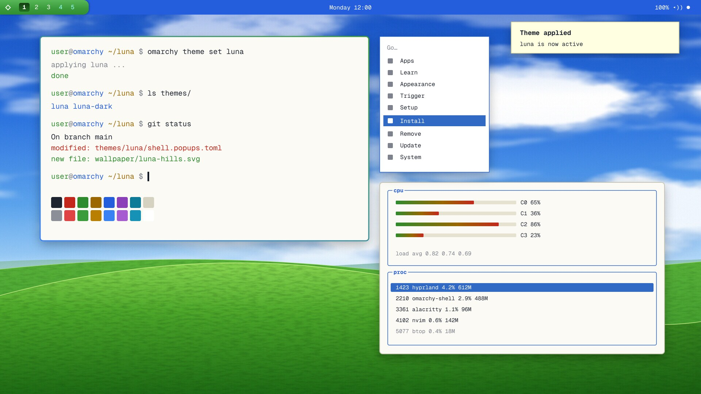
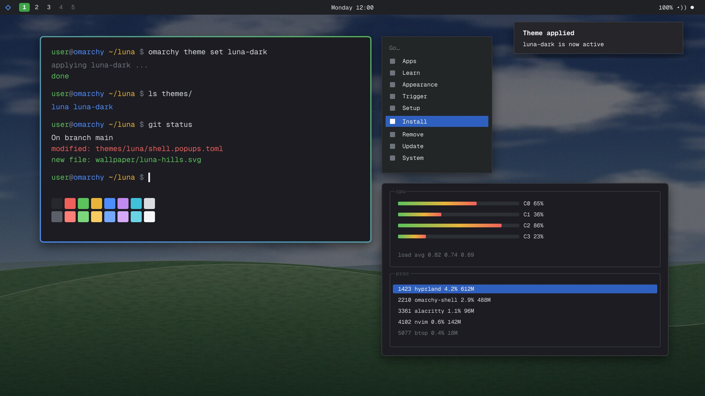

# omarchy-luna-theme

A Luna-inspired theme for [Omarchy](https://omarchy.org/), in two variants, with a matching bar widget and cursor.

- **luna**: light. Blue bar, a green "start block" holding the logo and workspaces, beige chrome, balloon-yellow notifications.
- **luna-dark**: graphite. Green only on the active workspace, blue only as accent.
- **luna.start**: bar widget (logo + workspaces). Left click on the logo opens the Omarchy menu, right click opens a terminal. Click a number to focus it, scroll to move between workspaces.
- **ModernXP cursor**, applied automatically with either variant.
- Active window border is a 2px blue to green gradient at 45 degrees.

| Light (`luna`) | Dark (`luna-dark`) |
| :---: | :---: |
|  |  |

*These screenshots are approximations: renders composed from this repo's own theme files and wallpaper (`docs/make-previews.sh`), not captures of a real desktop. Icons and details differ slightly from the real thing.*

## Install

Requires Omarchy 4.5+ and `jq`.

```bash
git clone https://github.com/raccoon-overlord-dev/omarchy-luna-theme.git
cd omarchy-luna-theme
./install.sh
```

The script installs both themes, the widget, the cursor and a `theme-set` hook, offers Open Sans as the GTK font (optional, `LUNA_OPENSANS=1|0` skips the question), and applies `luna`.

```bash
omarchy theme set luna        # light
omarchy theme set luna-dark   # dark
```

Switching to any other theme puts your previous bar widgets and cursor back (the hook saves them in `~/.local/state/omarchy/luna/`).

## Uninstall

```bash
./uninstall.sh
```

Leaves the Luna themes, restores your bar and cursor, and removes everything the installer added.

## Layout

```
themes/luna, themes/luna-dark   theme files (colors.toml, shell.*.toml, btop.theme, wallpaper)
plugin/luna-start               the bar widget
hooks/theme-set.d/luna.sh       bar + cursor swap on theme change
cursors/                        ModernXP cursor (prebuilt + source)
wallpaper/luna-hills.svg        source of the wallpaper
```

Widget colors come from the theme's `[luna]` section (`shell.luna.toml`) and fall back to the native bar colors.

## Credits and licenses

- **Cursor:** ModernXP, built from a patched fork of [na0miluv/modernXP-cursor-theme](https://github.com/na0miluv/modernXP-cursor-theme), GPL-3.0. All credit for the artwork goes to the original author. Full source is in `cursors/ModernXP-src`.
- **Wallpaper:** original artwork (`wallpaper/luna-hills.svg`), not affiliated with any other work.
- Copyright (C) 2026 raccoon-overlord-dev. Released under GPL-3.0 (see `LICENSE`), matching the bundled cursor. The cursor stays under its own authors' copyright.
- Luna-inspired only: not affiliated with or endorsed by Microsoft.
